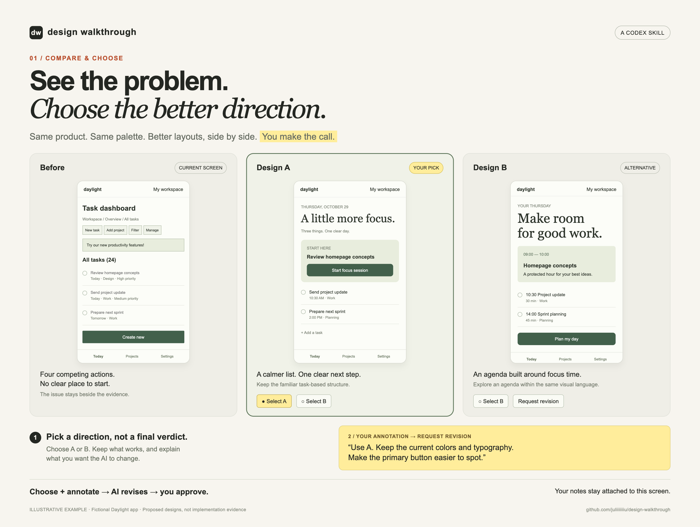
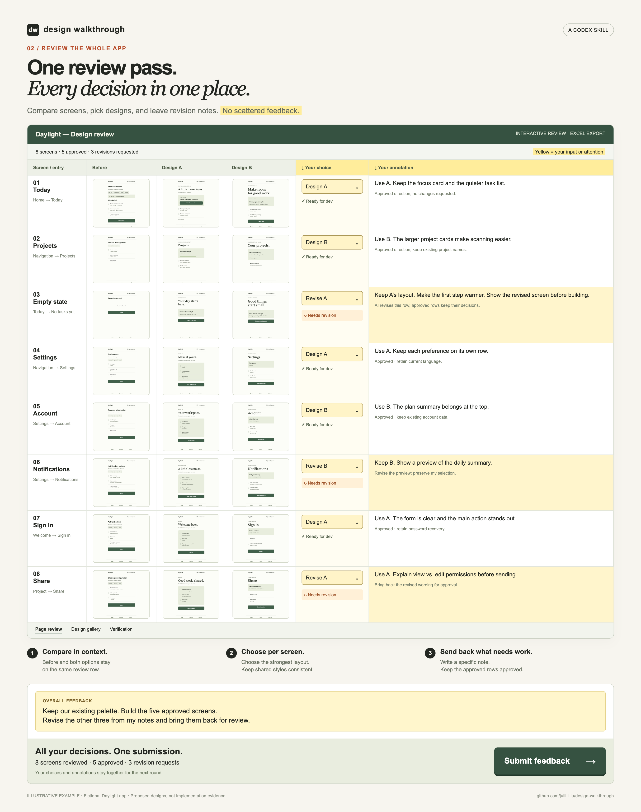

# Design Walkthrough

**Stop being the person who has to spot the same UI problems after every AI coding session.**

A Codex skill that walks through your app, turns scattered feedback into a page-by-page review, and checks the implementation against the design you approved.

Your app runs. The build passes. But a button disappears on mobile, the same action looks different across screens, and yesterday's feedback gets lost in another chat. You end up opening every page and explaining the problems again.

Design Walkthrough gives that work a repeatable process, with screenshots, editable decisions, and evidence of what was actually checked.

## See it in one review pass

Compare the current screen with multiple design options that preserve the same product palette. Choose a better layout, annotate what should change, and return the review to your AI.



Review all pages together. Approve some, request revisions on others, and keep each decision beside its screen. The optional interactive review surface shown below collects page-level annotations and overall feedback, with one **Submit feedback** action at the bottom.



*Illustrative examples using a fictional Daylight app. These images explain the workflow; they are not screenshots of an implemented product or a downloadable workbook.*

Portrait versions: [Compare and choose](docs/media/compare-portrait.png) · [Review the whole app](docs/media/review-portrait.png).

## How it works

1. **Learn your project.** Read its design system, components, tokens, brand guidance, and instructions. Use the product's own visual language as the starting point.
2. **Run the checks you already have.** Discover the project's lint tools and run relevant checks without auto-fixing. Connect useful diagnostics to the screens and components they affect.
3. **Walk through real screens.** Follow actual entry points and inspect meaningful states. Capture screenshots and flag incomplete or unreachable flows.
4. **Give you a review you can edit.** Create an Excel workbook with each screen's purpose, entry point, current appearance, issue, proposed change, your decision, and verification status.
5. **Implement when you ask.** Carry your selected designs into the code, reopen the affected flows, and compare implementation screenshots with the approved target. Record remaining differences and missing evidence.

You can stop at the review, revise proposals, or continue into implementation. An audit does not automatically authorize code changes.

## What lint adds

A walkthrough can catch a problem once. A well-scoped rule can help catch it again before the next review.

The skill reuses each project's tools rather than requiring ESLint or a particular framework. It distinguishes a clean lint result from a design requirement that has no automated coverage.

When adding checks is part of the requested work, stable project contracts can become rules: approved icon imports, token usage, or statically checkable accessibility properties. Rules stay in the project and are checked against violating, valid, and exception cases.

Layout, visual hierarchy, rendered contrast, and usability still need the running application. Passing lint never substitutes for seeing and using the page.

## What you get

- An editable Excel review with screenshots or evidence links.
- Proposals grounded in your project's style and user tasks.
- Relevant lint findings linked to affected screens where the relationship is known.
- Preserved decisions and annotations as the review evolves.
- After requested implementation, comparison evidence and explicit remaining or unverified items.

## Install

Clone this repository into your Codex skills directory:

```sh
git clone https://github.com/juliiiiiiiu/design-walkthrough.git ~/.codex/skills/design-walkthrough
```

If you use a custom `CODEX_HOME`, install under its `skills/design-walkthrough` directory. If that directory already exists, preserve or update the existing installation instead of overwriting it.

## Try it

For a first review:

```text
Use $design-walkthrough to review this project's main screens.
Run the relevant existing lint checks, walk through the app, and create
an editable Excel review with screenshots and two design options per screen.
Include editable choices and annotation fields so I can review everything together.
Keep implementation for after I review the proposals.
```

For a focused walkthrough:

```text
Use $design-walkthrough to review onboarding and settings on desktop
and mobile. Include empty, loading, and error states where available.
Keep the proposals consistent with our existing design system.
```

To continue after reviewing:

```text
Use $design-walkthrough to implement the items I marked ready in the
review workbook. Preserve my notes, rerun the relevant checks, and
compare the implemented screens with the approved designs.
```

## Access and limits

A full walkthrough needs project sources, a running application, and suitable browser or device access. Workbook creation requires spreadsheet tooling in the agent environment.

Existing lint tooling is reused when available. Missing tooling or unsupported checks are recorded as coverage gaps; an audit does not silently install dependencies or rewrite your configuration. Screenshot-only reviews remain useful, but cannot prove interaction behavior or static-check results.

The workflow adapts to the project's supported platforms. It does not assume a framework, impose a new design system, or claim untested screens passed.

## Skill files

- [SKILL.md](SKILL.md): the review, lint, design, and verification workflow.
- [agents/openai.yaml](agents/openai.yaml): the Codex display name and invocation prompt.
